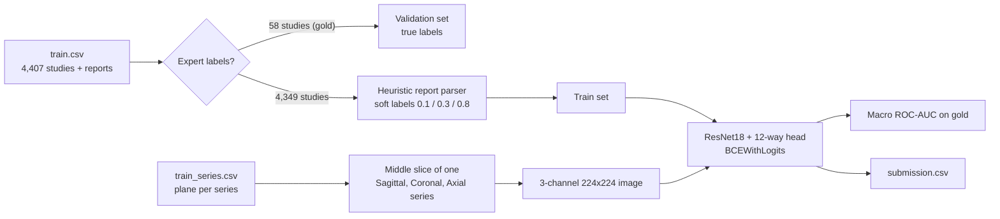

# RSNA Knee Abnormality Detection: Baseline Pipeline

A PyTorch baseline for the **RSNA Knee Abnormality Detection** Kaggle competition. Given a knee MRI study (several DICOM series across three anatomical planes), predict the probability of **12 findings** such as ACL tear, meniscus tears, osteoarthritis, effusion and fracture.

The twist in this competition is the labels: only **58 of 4,407** training studies have expert annotations. Every study does have a free-text radiology report, so this repo explores turning reports into **heuristic soft labels** to train on the full set.

> **Status: working baseline, not a finished solution.** The data loading, multi-plane input, validation metric and heuristic labeler are in place. The notebook contains no recorded validation scores, and the full-data training run was never executed. See [docs/04-limitations-and-roadmap.md](docs/04-limitations-and-roadmap.md) for an honest account.

---

## Pipeline at a glance



## The 12 targets

`ACL`, `MCL`, `Medial Meniscus`, `Lateral Meniscus`, `Medial OA`, `Lateral OA`, `PF OA`, `Effusion`, `Synovitis`, `Baker's`, `Contusion`, `Fracture`

Multi-label: one study can be positive for several at once, so the model uses 12 independent sigmoid outputs.

## Data snapshot (from the notebook's audit)

| Item | Value |
|---|---|
| Training studies | 4,407 |
| Studies with all 12 expert labels ("gold") | 58 |
| Studies with partial labels | 0 |
| Studies with a text report | 4,407 (4,276 unique) |
| Training series | 24,371 (3 to 14 per study, median 5) |
| Series by plane | Sagittal 9,864, Coronal 8,609, Axial 5,898 |
| Local test set | 3 studies (Kaggle swaps in the hidden test set at scoring) |
| Train/test study overlap | 0 |

Gold-set positive rates range from 15.5% (MCL) to 60.3% (Effusion). See [docs/01-problem-and-data.md](docs/01-problem-and-data.md).

## Repo layout

```
rsna-knee-abnormality/
├── README.md
├── requirements.txt
├── LICENSE
├── notebooks/
│   └── rsna-knee-abnormality-pipeline.ipynb   # original Kaggle exploration notebook
├── src/rsna_knee/
│   ├── config.py     # target columns, plane order
│   ├── data.py       # metadata loading + multi-plane DICOM dataset
│   ├── labels.py     # report -> heuristic soft labels
│   ├── model.py      # ResNet18, 12-way head
│   ├── train.py      # training + validation (gold or heuristic labels)
│   └── predict.py    # inference -> submission.csv
└── docs/
    ├── 01-problem-and-data.md
    ├── 02-pipeline-explained.md
    ├── 03-heuristic-labeling.md
    └── 04-limitations-and-roadmap.md
```

The notebook is the record of how the work evolved. The `src/` package is the same logic cleaned up into reusable, runnable modules (with the bugs listed in the limitations doc fixed).

## Quick start

Requires Python 3.10+ and, ideally, a GPU. The competition data must be downloaded from Kaggle separately and is not part of this repo.

```bash
git clone https://github.com/<your-username>/rsna-knee-abnormality.git
cd rsna-knee-abnormality
pip install -r requirements.txt
pip install -e .   # optional; or run with PYTHONPATH=src
```

Point `--data-dir` at the folder containing `train.csv`, `train_series/`, `test_series/` and so on. On Kaggle that is `/kaggle/input/competitions/rsna-knee-abnormality-detection`.

```bash
# 1. (optional) inspect the heuristic labels
PYTHONPATH=src python -m rsna_knee.labels --data-dir $DATA --out heuristic_train_labels.csv

# 2. train: heuristic soft labels for training, the 58 gold studies for validation
PYTHONPATH=src python -m rsna_knee.train --data-dir $DATA --label-source heuristic --epochs 5 --out-dir outputs

#    or: train only on the gold studies (random 80/20 split)
PYTHONPATH=src python -m rsna_knee.train --data-dir $DATA --label-source gold --epochs 5 --out-dir outputs

# 3. predict
PYTHONPATH=src python -m rsna_knee.predict --data-dir $DATA --checkpoint outputs/best.pth --out submission.csv
```

Training writes `outputs/best.pth` (best validation macro-AUC) and `outputs/metrics.json` (per-epoch loss, macro-AUC and per-class AUC).

## Key design choices

- **Metric**: macro ROC-AUC over the 12 targets, skipping any target whose validation set has only one class (common with tiny validation sets).
- **Input**: one middle slice per plane, stacked as 3 channels so an ImageNet ResNet can be used unchanged.
- **Loss**: `BCEWithLogitsLoss`, which accepts soft targets such as 0.8 or 0.1, so heuristic labels plug in directly.
- **Validation on real labels**: in heuristic mode, the 58 gold studies are held out entirely from training, so the score reflects agreement with experts rather than with the heuristic.

## Honest caveats

- One slice per plane discards most of each MRI volume. Findings away from the middle slice will be missed.
- Heuristic labels are noisy. A model can only learn to be as good as its labels, and a few dozen gold studies give a very noisy validation estimate.
- This is a learning and exploration project. Nothing here is a medical device or suitable for clinical use.

## Acknowledgements

Competition data and task by RSNA via Kaggle. The notebook explored using soft labels from a public community notebook (`raptor_sub.csv`); that experiment is not part of the packaged code. If you use external labels or models, check the competition rules first.

## License

MIT, for the code in this repo. The competition data is governed by the Kaggle competition's own terms.
